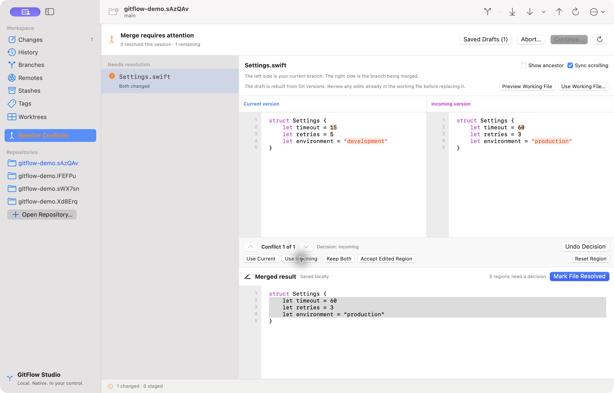

# GitFlow Studio

A native macOS Git client built with Swift 6, SwiftUI, AppKit, and the installed Git CLI. The main workflow is an index-aware three-way conflict workspace with editable results and explicit staging and continuation.

This is a working engineering preview, not a certified production release. See [release status](Documentation/RELEASE_STATUS.md) and [ROADMAP.md](ROADMAP.md) for verified scope and remaining work. There is no web frontend, backend service, account requirement, telemetry, or third-party package dependency.



## Build and run

Requirements: macOS 14 or later, Swift 6, and Git. Xcode Command Line Tools are sufficient for the Swift Package Manager build:

```sh
xcode-select --install       # Only if the tools are not already installed
./scripts/test.sh
./scripts/build-app.sh --open
```

The script produces `build/GitFlow Studio.app`, signs it ad hoc for local use, and verifies its signature. You can also run `swift run --build-system native GitFlowStudio` during development. To request a universal binary, use `UNIVERSAL=1 ./scripts/build-app.sh`; Intel execution requires separate verification on Intel hardware.

For Xcode, open `GitFlowStudio.xcodeproj`, choose the **GitFlowStudio** scheme, and run. The project requires Xcode 16 or later, uses a synchronized app-source group, and links the local `GitCore` package product. On the installed Swift 6.4 Command Line Tools, the test script supplies Apple’s Swift Testing framework and macro paths, which the default toolchain invocation omits. It disables XCTest because CLT does not ship that test runner. With full Xcode it uses normal SwiftPM. The `ViewState` type alias selects the macOS 14-compatible SwiftUI property wrapper when compiling against SDK 27, which also declares a same-named macro.

Core tests run through `./scripts/test.sh` or by opening `Package.swift` in Xcode. The Xcode scheme includes a native UI test target for real staging/commit and merge workflows; its execution requires full Xcode and an unlocked desktop. See [release instructions](Documentation/RELEASING.md).

## Try a real merge conflict

```sh
./scripts/make-conflict-demo.sh
```

Open the printed temporary folder in GitFlow Studio. It contains two branches whose changes conflict in `Settings.swift`. Select a conflict region, choose a version or edit the merged result, then explicitly mark the file resolved. Review the staged changes before choosing **Continue merge**. The fixture is disposable and never touches an existing repository.

## Implemented workflows

- Open, initialize, clone, recent repositories, Finder/editor integration, folder drops, and multiple windows.
- Working-tree and staged changes, file/hunk/individual-line staging and unstaging, confirmed unstaged discard, commits and confirmed amend.
- Paginated history with native graph lanes, commit details/parents, search, comparison, cherry-pick, and revert.
- Create, switch, rename, safely delete, track, compare, merge, and rebase branches.
- Fetch, explicit fast-forward/merge/rebase pull, upstream publication, push, remote configuration, stashes, and annotated tags.
- Local repository identity, co-authored commits, a protected `.gitignore` editor, linked worktree creation/move/lock/prune, and confirmed undo of an unpublished latest commit.
- Actual unmerged-index conflict detection, editable native three-way text results, bounded word highlights, region choices, source scrolling synchronization, optional ancestor, whole-file binary/symlink/deletion choices, stale-state checks, and explicit continuation/abort.
- Close, quit, and repository-switch confirmations protect unsaved conflict drafts and commit messages. Running Git operations must finish or be cancelled before closing.

The resolver supports UTF-8 text up to 8 MB per version. Other encodings and binary data use byte-preserving whole-version selection within that limit. Word comparison is bounded to 100 KB and 2,000 tokens per conflict side. Complex rename relationships, file/directory layouts, submodules, general working-diff word highlighting, and richer syntax analysis remain unfinished. Conflict drafts are saved locally after a 400 ms debounce and offered for explicit restoration only when the Git snapshot matches. Stale drafts remain available for review/export. Edits inside the debounce window may be lost on a crash; commit-message persistence is not implemented. See the [Desktop workflow evidence ledger](Documentation/DESKTOP_PARITY.md) for implemented, verified, partial, and missing behavior.

Individual-line selection supports ordinary regular-file text edits with final newlines. New/deleted/renamed files, metadata changes, binary content, and missing-final-newline cases use whole-file or supported hunk staging. Paths with invalid UTF-8 are rejected explicitly; they are never mapped to another filename using replacement characters. Non-UTF-8 file content can still be staged as a whole without changing its bytes.

## Git and authentication

Git is discovered at `/opt/homebrew/bin/git`, `/usr/local/bin/git`, then `/usr/bin/git`. Existing Git configuration, credential helpers, SSH agents, and hooks remain in use. Terminal credential prompts are disabled so a background process cannot hang waiting for invisible input. Configure the appropriate Git credential helper or SSH key outside the app if authentication fails. No credentials are persisted by GitFlow Studio.

Mutations sharing a common Git directory are serialized across app windows and linked worktrees. Git retains ownership of its index locks. Destructive and history-changing actions require explicit UI confirmation. Conflict saves validate the captured index and working-file state before replacing and staging a file. Git errors are surfaced instead of being treated as successful operations.

## Development and profiling

```sh
swift build --build-system native
./scripts/test.sh
swift run --build-system native -c release GitBenchmarks
swift run --build-system native -c release GitBenchmarks --quick
```

The benchmarks create and delete their own temporary repositories. See [PERFORMANCE.md](PERFORMANCE.md) for measured results and unmeasured targets, [ARCHITECTURE.md](ARCHITECTURE.md) for concurrency and process design, and [DESIGN.md](DESIGN.md) for interaction decisions.

## Distribution

`./scripts/release.sh preview` creates a local ZIP with checksums and readiness evidence. Developer ID signing/notarization commands are documented in [RELEASING.md](Documentation/RELEASING.md); App Store preparation and blockers are in [STORE_READINESS.md](Documentation/STORE_READINESS.md). The current suite has 67 passing integration tests plus two passing native UI tests on hosted Xcode 16.4. A universal arm64/x86_64 app cross-build succeeded; Intel execution remains unverified.

The local `.app` is not notarized. A distributable release needs a Developer ID identity, hardened-runtime signing, notarization, stapling, and clean-machine validation. App Sandbox is intentionally disabled: arbitrary repository access, installed Git, SSH agents, credential helpers, external hooks, and configuration span the sandbox boundary. A future Mac App Store build needs a separate entitlement and helper architecture; adding sandbox flags alone is insufficient.

## Functional reference

GitHub Desktop's [public source](https://github.com/desktop/desktop), [documentation](https://docs.github.com/en/desktop), [status plumbing](https://github.com/desktop/desktop/blob/development/app/src/lib/git/status.ts), and [merge plumbing](https://github.com/desktop/desktop/blob/development/app/src/lib/git/merge.ts) informed workflow organization and Git-state handling. This app is independently implemented and does not use Desktop branding, artwork, or source code.

See [the operation-by-operation source review](Documentation/GITHUB_DESKTOP_REFERENCE.md) for the pinned Desktop revision and implementation choices.
